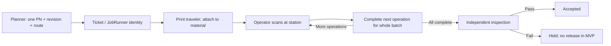
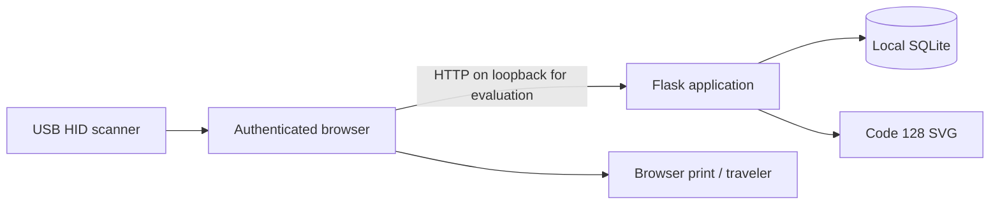

# Product and software architecture — provisional MVP

## Product boundary

ProductionRunner manages a ticket for one part number and revision. A JobRunner is the physical identity and instruction traveler for that ticket's material. The traveler remains with the material; the live ticket is authoritative for status. Printing does not advance production or authorize release.

A planner establishes quantity, instructions, acceptance criteria and an ordered route. Operators record full-batch operation completion in batch mode; new serial tickets record completion for each unit. An independent inspector records evidence and pass/fail. Pass accepts the batch or unit; fail holds the batch or unit. No endpoint bypasses these transitions.

## Implementation and deployment boundary

Server-rendered HTML keeps the first workflow small and inspectable. Flask handles sessions, validation, rendering and role checks; python-barcode produces Code 128 SVG; SQLite stores durable records. No external service, AI API or ERP integration is required. This is a proposed evaluation stack, not an assumed PR v1.9 mandate.

For a future station network: browser clients on the shop-floor network reach a centrally managed HTTPS application service; only that service accesses its database. Use managed application processes, restricted database/storage access, individual identity, backups and monitoring. Do not share SQLite via a network filesystem or expose the Flask development server. Decide whether to migrate the database after confirming multi-station load and the approved stack.

## Domain model

| Entity | Responsibility |
|---|---|
| User | Global individual identity: unique username and password hash |
| Tenant / membership | Organization identity and per-user roles in that organization |
| Ticket | Tenant-owned; stable `JR-` identity, single PN/revision, quantity, tracking mode, serial inventory, instructions, state, version, creator/time |
| Operation | Ticket, unique sequence, instructions, completion actor/time |
| Inspection | One final outcome per ticket, inspector, result, evidence/time |
| Event | Ordered audit entry, ticket, actor, action, detail, UTC time |

New serial tickets normalize units, per-unit completions and per-unit inspections. The ticket’s JSON serial list is retained as its creation inventory; the application does not edit identities or route definitions after creation. Earlier tickets without unit records keep their original whole-batch semantics. Cross-ticket uniqueness and genealogy remain unresolved.

## State and consistency

`ready → in_progress → awaiting_inspection → accepted | held`. A one-step route moves directly from `ready` to `awaiting_inspection` on completion. Ticket creation and route insertion share one transaction. Operation and inspection writes acquire `BEGIN IMMEDIATE`, compare the submitted version to the current ticket version and commit their event in the same transaction. Duplicate/stale forms return HTTP 409; they do not create duplicate events. Operation sequence is checked server-side, not trusted from the form. Inspection checks every completed operation's actor. Held work can enter an admin-authorized rework case; it remains held until an independent passing reinspection. Accepted work is terminal.

Event updates/deletes are blocked by SQLite triggers. This is application audit history, not cryptographic tamper evidence: a database owner can alter schema or data. Retention and external audit export remain production work.

## Permission matrix

| Action | Planner | Operator | Inspector | Viewer | Admin |
|---|---|---|---|---|---|
| View/scan ticket and traveler | Yes | Yes | Yes | Yes | Yes |
| Create ticket/route | Yes | No | No | No | No |
| Request print/reprint | Yes | Yes | No | No | No |
| Complete next operation | No | Yes | No | No | No |
| Inspect completed batch | No | No | Yes, if independent | No | No |
| Directly bypass inspection / release hold | No | No | No | No | No |

Roles combine explicitly, but independence is based on actor identity. All authenticated users may view/print a traveler through the browser; the print-request action records intent, not a physical print guarantee. Admins manage tenant users and PINs, cancel nonaccepted tickets and authorize rework. Operators complete repairs; independent inspectors reinspect. Admin does not imply either execution role. Trusted local-host CLI provisioning remains available.

## Security and operating limits

Passwords are hashed with Werkzeug; accounts are never seeded. Signed HttpOnly/SameSite session cookies expire after eight hours. Forms use CSRF tokens; templates escape user text; CSP disallows external resources and framing. The session key is generated in ignored `instance/` with restrictive file mode, or supplied through `PR_SECRET_KEY`. Set `PR_HTTPS=1` only behind HTTPS to enable Secure cookies.

Local evaluation still lacks centralized identity/MFA, password reset/revocation, full user-management auditing, general session revocation, operational alerting and comprehensive backup/restore tooling. Add these before a networked pilot. No background processing, offline writes or ERP credentials are included. During connectivity loss, do not infer authorization from an old paper status.

## Sources used for implementation

- [Flask security guidance](https://flask.palletsprojects.com/en/stable/web-security/): session-cookie and CSRF considerations.
- [python-barcode supported formats](https://python-barcode.readthedocs.io/en/stable/supported-formats.html): Code 128 generation and checksum handling.
- [python-barcode writers](https://python-barcode.readthedocs.io/en/stable/writers.html): SVG sizing and quiet-zone options.

## Tenant isolation slice

Login requires organization slug, individual username and either a password or enrolled tenant PIN. The signed session stores the tenant ID only after membership verification; every request reloads membership and its roles. There is no implicit/default organization and no global role fallback. Switching organizations requires signing in again, rotating the CSRF token. An original pre-migration session cannot access protected routes.

Tickets, operations, inspections and events carry tenant IDs. Queue, ticket, scan, traveler, barcode, production, inspection and audit reads/writes are scoped to the current membership. Known IDs from another organization return 404 to authorized action roles, just like unknown IDs. Form/query tenant fields never select ownership. Composite foreign keys link child records to their tenant-owned ticket and actors to membership in that tenant. Revocation clears membership roles rather than deleting historical identity links. SQLite foreign keys are enabled on application and provisioning connections.

`migrate-tenancy` is an offline, explicit migration for the original MVP only. It makes a private, non-overwriting SQLite backup, rebuilds tables in one exclusive transaction, preserves legacy IDs/data, and checks foreign keys before commit. All old records go to the one explicitly named organization. It does not infer ownership or split previously mixed-company data. Stop writers before backup/migration and retain the prior application version for backup restoration.

Application tenant isolation does not restrict a trusted database/file administrator. Existing production authentication/hosting limitations still apply. Web account creation and all web/CLI membership changes are audited; original CLI add-user bootstrap provisioning remains a trusted host action.

## PIN credentials and authentication audit

`pin_credentials` is keyed by tenant membership and stores only a Werkzeug hash and credential version. A PIN-authenticated session records that version; reset/disable changes the version atomically with an append-only `auth_events` entry. Each request verifies the credential version and reloads the membership. Revoked memberships clear the browser session. Password sign-in remains available and is not revoked by PIN reset.

`set-pin` is trusted local-host administration with hidden, confirmed input and a required reason. It does not grant any role. CLI audit attribution is the local OS account, not an asserted web administrator. Security history is tenant-admin-only and shows the latest 200 entries. Successful and failed sign-ins for active memberships are recorded without submitted credentials; unknown/revoked identities are covered by throttling but do not create membership audit rows. Throttled attempts do not create repeated audit rows.

Persistent fixed windows limit failed account and source-address attempts across both credential methods, including after process restart. SQLite `BEGIN IMMEDIATE` serializes counter updates, credential verification and audit writes. This favors simple correctness for local evaluation; password hashing while holding the SQLite writer lock limits concurrency and must be revisited for production scale. Unknown identities use a dummy hash verification. Proxy headers are ignored. Shared-proxy throttling, offline attacks against short PIN hashes, shared-station session policy, recovery UX, comprehensive security monitoring and deployment hardening still require production review. PINs are not electronic-signature or regulatory compliance claims.

## Independent serial execution

New serial tickets create one `serial_units` row and stable `JR-U-` traveler ID per serial in the same transaction as ticket/route creation. A shared immutable route definition lives in `operations`; `unit_completions` records each unit/operation once. Composite foreign keys ensure units, route operations, inspections and audit links belong to the same tenant and ticket. `unit_inspections` allows one final result per unit. Inspector independence is evaluated against contributors to that unit, including dual-role users. Work on another unit is allowed under this provisional policy.

Each unit has its own workflow state and optimistic version. `BEGIN IMMEDIATE` plus the submitted unit version prevents duplicate/stale writes while allowing two units to advance without conflicting on the parent version. Ticket-wide completion/inspection endpoints reject tickets with unit records. Unit events are written into the existing immutable ticket event stream and associated through immutable `unit_event_links`, so both ticket and unit history remain available. Workflow writes, summary updates and audit links commit or roll back together.

Ticket state is a summary: any held unit → held; all accepted → accepted; all ready → ready; only awaiting-inspection/accepted units → awaiting_inspection; otherwise → in_progress. A held summary does not block work on other units. A held/accepted unit itself has no outgoing actions. Ticket pages show completed step counts per unit; scans resolve either the ticket overview or an individual unit. Parent printing produces a cover sheet; unit printing produces a quantity-one traveler. Neither paper nor ticket summary authorizes shipment.

`init-db` adds the serial tables/indexes without rewriting old tickets. Existing serial inventory continues whole-batch execution, including its original independence rule. No silent historical backfill or conversion is performed. This slice does not implement unit-specific route definitions, serial reassignment, split/merge, genealogy, multi-step rework routes, concessions, or global serial uniqueness. Physical unit traveler qualification remains outstanding.

## HOT queue priority

An optional `ticket_priorities` row references the owning tenant/ticket and stores rank and original HOT time. No row means normal. Queue sorting uses rank and timestamp ahead of the existing normal newest-first order, with ticket ID as a deterministic tie breaker. Planner/admin changes use the ticket transaction/version lock and append a `priority_changed` event; setting an unchanged value is a no-op. Unit progress/version is unaffected, but batch forms opened before a priority change must reload. Serial units display their parent’s current priority. Additive schema initialization preserves existing records.

## Part and drawing revisions

`part_revisions` is a tenant-scoped PN/revision library containing either immutable PDF bytes plus SHA-256 or an immutable external HTTPS URL. Metadata queries exclude the BLOB. `ticket_drawings` fixes one revision reference per ticket, inherited by its units; composite ownership foreign keys prevent cross-tenant references. `part_events` records attributed revision creation. Revision rows, ticket associations and library events reject updates/deletes through database triggers. No change/replace endpoint is exposed.

Ticket creation resolves a selected library ID within the current tenant and treats its PN/revision as authoritative. Manual entry matches only the exact PN/revision. Attachment and ticket audit writes share the creation transaction. Existing unmapped tickets require an explicit planner/admin matching action under the ticket version lock; adding a library entry alone does not alter an existing ticket. The read-only drawing panel never infers a new mapping.

Uploads are capped at 10 MB and stored transactionally in SQLite, avoiding orphan filesystem files and including drawing bytes in existing backup procedures. The new-part multipart endpoint allows a 31 MB envelope for a 10 MB PDF plus a 20 MB optional DXF; the separate DXF attachment endpoint allows 21 MB; other endpoints retain 64 KB request limits. PDF responses override the general CSP with a sandbox policy, retain no-store/nosniff headers, and use a sanitized download name. Signature/extension checks are not full PDF validation or malware scanning. HTTPS links reject credentials and malformed/unsafe schemes; links are displayed with a mutability notice before navigating externally and are never server-fetched. External file content cannot be frozen by saving its URL.

Formal document approval, supersession/withdrawal, revision correction, bulk import, CAD/image formats, antivirus scanning, external-system synchronization and production object storage remain out of scope. The part library is a reference catalog, not a released drawing authority.

## DXF production-file attachments

`part_dxf` stores one immutable file per tenant-owned part revision with original bytes, SHA-256, uploader and UTC time. Revision creation can add the file in the same transaction as its PDF/link and audit records. Existing revisions can receive their first DXF through a planner/admin-only POST. A unique key prevents competing uploads from replacing the first successful file; update/delete triggers preserve it. Existing ticket mappings resolve that same revision's DXF without copying or changing the drawing association.

CSRF-protected download POSTs authorize tenant membership, log `dxf_download_requested`, then send the exact bytes as an octet-stream attachment with a sanitized PN/revision filename, no-store/nosniff and sandbox headers. Download requests do not claim completed transfer, machine import or operation completion. The upload cap is 20 MB, with nonempty/extension checks only; opaque-byte storage preserves text and binary content without parsing or conversion. Laser integration, geometry/unit verification, executable toolpath generation and malware inspection are outside this feature.

## Admin controls

`membership_controls` stores optimistic edit versions and a separate session epoch per tenant/user. Role/access changes increment both; PIN changes increment the edit version and the existing PIN credential version. Login captures the epoch inside the authentication transaction; every request checks it before authorizing access. Revocation followed by restoration cannot revive an older session. Web changes require reasons and write immutable `auth_events` in the same transaction. `BEGIN IMMEDIATE` serializes last-admin checks and updates. Tenant admins can create new global usernames but cannot claim existing users or reset global passwords shared across organizations.

`ticket_cancellations` is an immutable sidecar preserving historical workflow states. Ticket/unit execution and rework writes check cancellation while holding the SQLite write lock. Queue and traveler views display cancellation; cancelled jobs sort last. This is a software recording gate, not a machine interlock.

`rework_cases` preserves the original inspection and records each repair round, authorization, instructions, criteria, production evidence and independent result. A partial unique index limits each batch/unit to one unresolved case. Versioned writes and ticket/unit audit events commit together. Inspection excludes all original and rework contributors for that batch/unit, across rounds. Pass updates the target state; serial summaries use the same aggregation as original inspection. Failure retains hold and permits another case. Final case evidence cannot be updated or deleted. The initial implementation is a single documented repair step, not a replacement routing engine.

## Organization profiles and admin navigation

`/admin` provides the central admin portal. `/admin/organization` reads the signed-in tenant and optional `organization_profiles` row. Tenant name remains in `tenants`; optional contact name/email, phone, address and optimistic edit version live in the additive profile table. Profile writes acquire a write lock, revalidate the acting admin’s membership/session epoch, check the submitted version, and commit name/profile changes with an immutable `organization_updated` security event. Ownership comes only from the authenticated tenant. Sign-in slug, organization creation and cross-tenant administration are confined to the separate developer portal; deletion is not exposed. Organization names on rendered travelers use the current display name, not a historical name snapshot.

## Developer administration boundary

`developer_accounts` is a distinct credential domain, not a membership role or a user flag. `/developer/login` establishes only developer identity/version in the session and clears any organization identity. Every developer request reads active status/version; mutation handlers recheck it after acquiring the write lock. Local user/PIN endpoints cannot address developer credentials even when numeric IDs coincide. Host-only CLI provisioning prevents local admins promoting themselves.

`platform_events` stores immutable actor/action/details and optional target tenant. It records global organization creation, profile edits and local admin assignment, atomically with the domain writes. Organization creation requires a new local admin identity in the same transaction; duplicate names/codes or audit failures roll back both. Local admin changes preserve other roles and share membership versions/epochs and last-admin protection with the local console. Profile changes share the same optimistic version with local admin edits. Platform history is global only to developers; organization Security History filters developer events by the authenticated tenant. No impersonation, tenant-data execution bypass, deletion or suspension is introduced.
