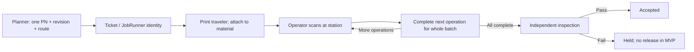
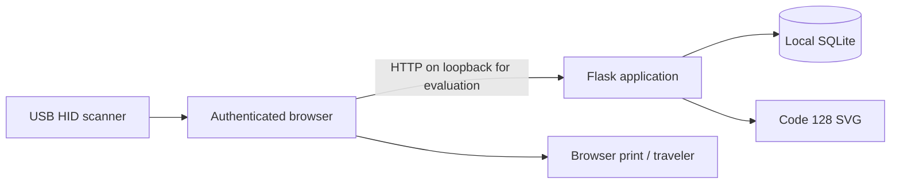

# Product and software architecture — provisional MVP

## Product boundary

ProductionRunner manages a ticket for one part number and revision. A JobRunner is the physical identity and instruction traveler for that ticket's material. The traveler remains with the material; the live ticket is authoritative for status. Printing does not advance production or authorize release.

A planner establishes quantity, instructions, acceptance criteria and an ordered route. Operators record full-batch operation completion. An independent inspector records evidence and pass/fail. Pass accepts the batch; fail holds it. No endpoint bypasses these transitions.

## Implementation and deployment boundary

Server-rendered HTML keeps the first workflow small and inspectable. Flask handles sessions, validation, rendering and role checks; python-barcode produces Code 128 SVG; SQLite stores durable records. No external service, AI API or ERP integration is required. This is a proposed evaluation stack, not an assumed PR v1.9 mandate.

For a future station network: browser clients on the shop-floor network reach a centrally managed HTTPS application service; only that service accesses its database. Use managed application processes, restricted database/storage access, individual identity, backups and monitoring. Do not share SQLite via a network filesystem or expose the Flask development server. Decide whether to migrate the database after confirming multi-station load and the approved stack.

## Domain model

| Entity | Responsibility |
|---|---|
| User | Global individual identity: unique username and password hash |
| Tenant / membership | Organization identity and per-user roles in that organization |
| Ticket | Tenant-owned; stable `JR-` identity, single PN/revision, quantity, tracking mode, serial inventory, instructions, state, version, creator/time |
| Operation | Ticket, unique sequence, instructions, completion actor/time |
| Inspection | One final outcome per ticket, inspector, result, evidence/time |
| Event | Ordered audit entry, ticket, actor, action, detail, UTC time |

Serials are inventory identifiers in a JSON list in this slice. They do not have separate routes or production events. A production model supporting individual serialized movement should normalize units and their histories once the specification establishes uniqueness and genealogy rules.

## State and consistency

`ready → in_progress → awaiting_inspection → accepted | held`. A one-step route moves directly from `ready` to `awaiting_inspection` on completion. Ticket creation and route insertion share one transaction. Operation and inspection writes acquire `BEGIN IMMEDIATE`, compare the submitted version to the current ticket version and commit their event in the same transaction. Duplicate/stale forms return HTTP 409; they do not create duplicate events. Operation sequence is checked server-side, not trusted from the form. Inspection checks every completed operation's actor. Held and accepted states have no outgoing workflow actions.

Event updates/deletes are blocked by SQLite triggers. This is application audit history, not cryptographic tamper evidence: a database owner can alter schema or data. Administrative controls, retention and external audit export are production work.

## Permission matrix

| Action | Planner | Operator | Inspector | Viewer | Admin |
|---|---|---|---|---|---|
| View/scan ticket and traveler | Yes | Yes | Yes | Yes | Yes |
| Create ticket/route | Yes | No | No | No | No |
| Request print/reprint | Yes | Yes | No | No | No |
| Complete next operation | No | Yes | No | No | No |
| Inspect completed batch | No | No | Yes, if independent | No | No |
| Bypass inspection / release hold | No | No | No | No | No |

Roles combine explicitly, but independence is based on actor identity. All authenticated users may view/print a traveler through the browser; the print-request action records intent, not a physical print guarantee. User provisioning is an operator-controlled CLI, outside the web role matrix.

## Security and operating limits

Passwords are hashed with Werkzeug; accounts are never seeded. Signed HttpOnly/SameSite session cookies expire after eight hours. Forms use CSRF tokens; templates escape user text; CSP disallows external resources and framing. The session key is generated in ignored `instance/` with restrictive file mode, or supplied through `PR_SECRET_KEY`. Set `PR_HTTPS=1` only behind HTTPS to enable Secure cookies.

Local evaluation still lacks centralized identity/MFA, password reset/revocation, full user-management auditing, general session revocation, operational alerting and comprehensive backup/restore tooling. Add these before a networked pilot. No background processing, offline writes or ERP credentials are included. During connectivity loss, do not infer authorization from an old paper status.

## Sources used for implementation

- [Flask security guidance](https://flask.palletsprojects.com/en/stable/web-security/): session-cookie and CSRF considerations.
- [python-barcode supported formats](https://python-barcode.readthedocs.io/en/stable/supported-formats.html): Code 128 generation and checksum handling.
- [python-barcode writers](https://python-barcode.readthedocs.io/en/stable/writers.html): SVG sizing and quiet-zone options.

## Tenant isolation slice

Login requires organization slug, individual username and either a password or enrolled tenant PIN. The signed session stores the tenant ID only after membership verification; every request reloads membership and its roles. There is no implicit/default organization and no global role fallback. Switching organizations requires signing in again, rotating the CSRF token. An original pre-migration session cannot access protected routes.

Tickets, operations, inspections and events carry tenant IDs. Queue, ticket, scan, traveler, barcode, production, inspection and audit reads/writes are scoped to the current membership. Known IDs from another organization return 404 to authorized action roles, just like unknown IDs. Form/query tenant fields never select ownership. Composite foreign keys link child records to their tenant-owned ticket and actors to membership in that tenant. Revocation clears membership roles rather than deleting historical identity links. SQLite foreign keys are enabled on application and provisioning connections.

`migrate-tenancy` is an offline, explicit migration for the original MVP only. It makes a private, non-overwriting SQLite backup, rebuilds tables in one exclusive transaction, preserves legacy IDs/data, and checks foreign keys before commit. All old records go to the one explicitly named organization. It does not infer ownership or split previously mixed-company data. Stop writers before backup/migration and retain the prior application version for backup restoration.

Application tenant isolation does not restrict a trusted database/file administrator. Existing production authentication/hosting limitations still apply. User-provisioning and role-change audit events, and independent serial execution remain pending.

## PIN credentials and authentication audit

`pin_credentials` is keyed by tenant membership and stores only a Werkzeug hash and credential version. A PIN-authenticated session records that version; reset/disable changes the version atomically with an append-only `auth_events` entry. Each request verifies the credential version and reloads the membership. Revoked memberships clear the browser session. Password sign-in remains available and is not revoked by PIN reset.

`set-pin` is trusted local-host administration with hidden, confirmed input and a required reason. It does not grant any role. CLI audit attribution is the local OS account, not an asserted web administrator. Security history is tenant-admin-only and shows the latest 200 entries. Successful and failed sign-ins for active memberships are recorded without submitted credentials; unknown/revoked identities are covered by throttling but do not create membership audit rows. Throttled attempts do not create repeated audit rows.

Persistent fixed windows limit failed account and source-address attempts across both credential methods, including after process restart. SQLite `BEGIN IMMEDIATE` serializes counter updates, credential verification and audit writes. This favors simple correctness for local evaluation; password hashing while holding the SQLite writer lock limits concurrency and must be revisited for production scale. Unknown identities use a dummy hash verification. Proxy headers are ignored. Shared-proxy throttling, offline attacks against short PIN hashes, shared-station session policy, recovery UX, comprehensive security monitoring and deployment hardening still require production review. PINs are not electronic-signature or regulatory compliance claims.
